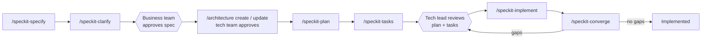

# How We Work — Spec Kit Framework Guide

**Last updated**: 2026-10-02 · Spec Kit 0.16.4

A short map of the framework. The rules themselves live in the files linked below; if this guide and a file disagree,
the file wins. Full scenarios: `framework-scenarios.md`.

## The normal path

## Commands

| Command | Use it for | Rules in |
|---|---|---|
| `/speckit-specify` | Any business input — file or description, whole or part, new and/or changes; it is routed automatically | `.claude/skills/framework-hooks`, `.claude/skills/intake`, spec template |
| `/amend ###` | Change, defer, cancel, or resume one existing feature | `.claude/skills/amend` |
| `/speckit-clarify` | Resolve open points in a spec | Spec Kit |
| `/architecture create \| update \| review` | Architecture for the whole approved scope; `review` = read-only impact estimate | `.claude/skills/architecture` |
| `/speckit-plan`, `/speckit-tasks`, `/speckit-implement` | Deliver an approved feature, including its acceptance test cases and their automated run (constitution, Quality Control) | Plan and tasks templates, `.claude/skills/link-qc-5-test-run-automation` |
| `/speckit-converge` | After **every** implement; also after an amendment instead of `/speckit-tasks` | Spec Kit |
| `/speckit-bug-assess`, `-fix`, `-test` | Defects (assessed against the spec) | `CLAUDE.md` (bug flow) |
| `/specs-to-workitems` | Azure DevOps: Epic → Feature → User Story | `.claude/skills/specs-to-workitems` |

## Who approves

| What | Who | Recorded in |
|---|---|---|
| Spec (one by one; a change set together) | Business team | `spec.md` header |
| Architecture decisions and SAD approval | Tech team | `architecture/` |
| Plan + tasks (+ each converge section), bug assessments | Tech lead | `tasks.md`, `assessment.md` |

## Gates (`.specify/extensions.yml` → `framework-hooks`)

- **Before specify**: route the input.
- **Before plan**: spec (and change set) Approved · no `[NEEDS CLARIFICATION]` · architecture status allows it:
  Approved → yes; Update required → only features not named in that row (named features wait for
  `/architecture update`); Draft → no feature until it is approved.
- **Before implement**: every tasks section reviewed · dependencies Implemented (or an exception in the plan).
- The architecture skill itself refuses `create` / `update` on specs that are not Approved.

## Where status lives

| What | Where |
|---|---|
| Features, dependencies, waves, Spec and Delivery status | `specs/feature-map.md`; Delivery mirrored at the top of each `plan.md` and `tasks.md` |
| How features link | Spec **Dependencies**: **Depends on** (needs the other feature; sets the wave; the implement gate waits for it), **Related** (shares data or screens; either can be built first; no wave or gate). The map derives **Consumed by**. `/amend` checks Consumed by and Related features for a change set. |
| Architecture design, open items, approval | `architecture/solution-architecture.md` |
| Components and who introduced them | `architecture/component-register.md` |
| Progress of a feature | `tasks.md` checkboxes |
| Acceptance test cases and their execution | `specs/<NNN-feature>/TEST-CASES-<NNN-feature>.md` (`## Execution Results`); run and bug reports under `Testing/Automation/reports/<NNN-feature>/` |

## Working practices

- **Branches**: one branch per feature; pull request to main in Azure Repos.
- **Rollback**: revert the feature's pull request → DevOps redeploys → set Delivery back in the feature map with a
  note. Data changes: a forward fix migration.
- **Resume / handover**: everything is in the files (feature map, `tasks.md`, the SAD) — nothing depends on a
  chat session.
- **DevOps**: handover details for created or changed deployables are written at the end of implementation, from the
  real code.

## Open items

- How technical changes not tied to a feature are delivered (upgrades, refactoring, infrastructure).
- Where a feature's business area (Azure DevOps Epic) is recorded.
