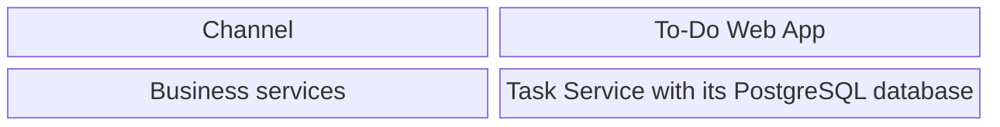

# Customer TBC — To-Do List

## Solution Architecture Document

<!--
  THE architecture document (architecture skill): high level only, in customer language. No business content (it
  lives in specs) and no plan or task content (Rule 8: ownership table and the three tests).
  - Status (Document History, latest row) — the only thing other files check (framework-hooks before_plan):
      Approved — Tech team   the architecture covers every Approved spec; features can be planned
      Update required        a new or changed spec affects the architecture; /speckit-specify, intake, or /amend added
                             this row with the features and their impact; planning is blocked until /architecture update
      Draft                  /architecture create or update is in progress; the Open Items section lists what to decide
  - The tech team resolves the Open Items one by one; when none is left the section is removed and the row becomes
    "Approved — Tech team". Only then can the document be delivered.
  - Cross-cutting rules are NOT repeated here: they live only in architecture/cross-cutting/.
  - Facts come from the ADRs; do not decide anything here.
  - Diagrams: the solution architecture diagram only (§3). No sequence or flow diagrams. A business lifecycle or status
    model shared by several features is business behaviour: it lives, with its diagram, in the spec of the feature
    that owns it, and the ADRs that rely on it link to that spec.
  - Minor decisions (no ADR) are written in the section they concern (4–9), or in a cross-cutting file when every
    feature must follow them.
  - Sections marked "(include if any)" are removed when they do not apply; keep the numbering of the rest.
-->

### Document History

| Version | Date | Status | Author | Summary of changes |
| --- | --- | --- | --- | --- |
| 0.1 | 2026-10-13 | Draft | /architecture create | First draft: building blocks, technology stack, cross-cutting rules |
| 1.0 | 2026-10-13 | Approved — Tech team (scope: all Approved specs) | Tech team review | ADR-0001 and ADR-0002 approved; cross-cutting rules approved; WCAG 2.2 AA; single instance and same origin confirmed; risks R-01, R-02 accepted; hosting TBC |

---

## 1. Introduction

This document is the high-level solution architecture for the To-Do List application. The platform lets people keep
a shared list of things to do and track which are done, through a single web application in English.

The architecture is deliberately small: one web application in the browser talks to one back-end service over
synchronous REST; that service owns the only database. There is no sign-in and no external system. Locally everything
runs on the developer's machine; the hosting target is TBC.

**Sources**

| Document | Version / date | Used for |
| --- | --- | --- |
| Constitution (`.specify/memory/constitution.md`) | v2.1.0 — 2026-10-13 | Principles, Platform Scope (one web channel, English, Africa/Cairo), quality control |
| Approved specifications (`specs/`, feature map) | 2026-10-13 | Scope, actors, data that must be kept, quality targets |
| Technology choices from the tech team | 2026-10-13 | Java 21, Spring Boot, React, Playwright |

---

## 2. Architecture Principles

| Principle | What it means here |
| --- | --- |
| **Simplicity** (Constitution VIII) | Only the blocks the approved scope needs: one web application, one service. No gateway, identity provider, broker or shared library until a feature needs one. |
| **Security by default** (Constitution I) | The absence of sign-in is an explicit, documented public-access decision; every input is validated by the service. |
| **Layered boundaries** (Constitution V) | Business rules live only in the service layer of the Task Service; the web application holds no business rules. |
| **Explicit contracts** (Constitution VI) | The web application uses the Task Service only through a versioned, documented API contract. |
| **Accessibility** (Constitution II) | The web application is usable with a keyboard and a screen reader, verified by automated checks. |

---

## 3. Solution Architecture Diagram

*Figure 1: The components of the To-Do List platform.*

---

## 4. Components and Ownership

### 4.1 Component catalog

| Component | Type | Responsibility | Owns data |
| --- | --- | --- | --- |
| **To-Do Web App** | Frontend | The single web channel: shows the list and lets people act on it in the browser | No |
| **Task Service** | Domain service | Task management: holds the business rules and keeps the list | Yes — its own PostgreSQL database |

### 4.2 Actors

| Actor | Access | Responsibility |
| --- | --- | --- |
| **Anyone with a browser** | To-Do Web App, no sign-in | Uses the shared list as the approved specifications allow |

### 4.3 How components communicate

| Mechanism | Used for | Characteristics |
| --- | --- | --- |
| **Synchronous REST over HTTP(S), JSON** | To-Do Web App → Task Service | Public (no sign-in), versioned contract, web application and API served from the same origin in every environment, HTTPS outside local; rules in `cross-cutting/api-contracts.md` and `cross-cutting/resilience.md` |

---

## 5. Business Domains

### 5.1 Task management

**Purpose:** Keep the shared list of things to do.

**Functionality:** Owns the list and every rule about what can be added, completed and removed; decides what is
stored and returned.

---

## 7. Presentation Layer

English only, left to right; Chromium on desktop is the supported browser (Constitution, Quality Control
configuration). Accessibility follows `cross-cutting/accessibility.md` at WCAG 2.2 level AA.

### 7.1 To-Do Web App

**Purpose:** The single channel of the product.

**Functionality:** A single-page application that shows the shared list and offers the actions the approved
specifications describe.

---

## 9. Data, Messaging and Deployment

| Component | Role |
| --- | --- |
| **PostgreSQL database of the Task Service** | Durable store of the list; only the Task Service reads or writes it; schema changes are versioned migrations |

No messaging and no file storage. The Task Service is stateless apart from its database and runs as one instance,
which is enough for the expected volume (a few hundred tasks, a small number of simultaneous users); being stateless,
it can run as several instances later without other changes. Locally, PostgreSQL runs in Docker Compose, the Task
Service runs from Maven, and the web application runs on its development server, which forwards API calls to the
service so both share one origin. Hosting target (cloud, on-premises or container platform), metrics export and the
secret store outside local: TBC — owned by the customer.

---

## 10. Technology Stack

| Component | Technology |
| --- | --- |
| To-Do Web App | React, TypeScript, Vite (Node.js LTS) |
| Task Service | Java 21, Spring Boot, Maven; Flyway migrations; OpenAPI contract via springdoc-openapi |
| Task Service database | PostgreSQL |
| Developer tests | JUnit with Testcontainers (Task Service); Vitest with React Testing Library (To-Do Web App) |
| Acceptance tests | Playwright (Chromium) with axe-core |
| Local environment | Docker with Docker Compose |

---

## 11. Alignment to Quality and Governance Requirements

| Requirement | How the architecture delivers it |
| --- | --- |
| **Public access is explicit** (Constitution I) | No identity provider; every operation is declared public in the API contract (`cross-cutting/security.md`) |
| **Server-side validation, no leaking internals** (Constitution I, VI) | All input validated in the Task Service; one error format without internal details (`cross-cutting/error-handling.md`) |
| **Accessibility verified** (Constitution II) | WCAG 2.2 AA; automated accessibility checks in the acceptance tests (`cross-cutting/accessibility.md`) |
| **Business rules in the service layer** (Constitution V) | Layering of `cross-cutting/code-structure.md` |
| **Versioned schema changes** (Constitution V) | Flyway migrations owned by the Task Service |
| **Diagnosable in production** (Constitution VII) | Structured logs with correlation IDs and health endpoints (`cross-cutting/observability.md`) |
| **One time zone** (Constitution, Platform Scope) | `cross-cutting/date-and-time.md` |

**Accepted risks** (Tech team, 2026-10-13)

| ID | Risk | Mitigation |
| --- | --- | --- |
| R-01 | Without sign-in, anyone who can open the application can change or remove everything in the list, or flood it | Accepted by the business scope; rate limiting or sign-in can be added later through a spec change |
| R-02 | People may type personal data into a list that everyone can read | Restrict network access to the application until the hosting target is decided |
