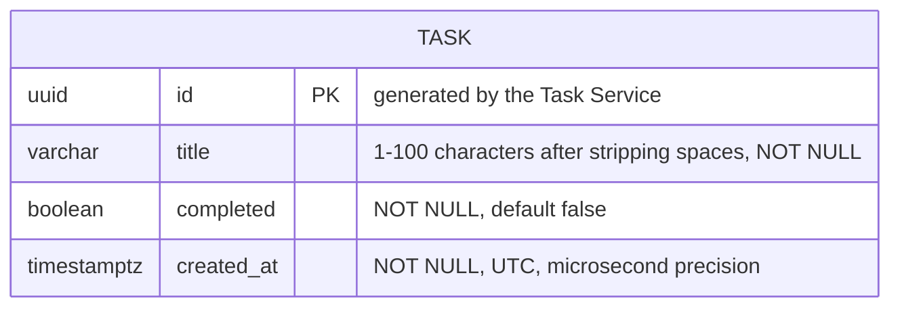

# Data Model: To-Do List (001)

**Owning service**: Task Service — PostgreSQL database `todo` | **Plan**: [plan.md](plan.md)

There are no relationships: the feature has one entity and no earlier features.

## Task

| Field | Type (database) | API field | Rules |
|-------|-----------------|-----------|-------|
| `id` | `uuid`, primary key | `id` (string) | Random UUID generated by the service on create; opaque to the client |
| `title` | `varchar(100)`, not null | `title` (string) | Leading and trailing white space removed (including non-breaking spaces; research R2); then 1–100 UTF-16 code units (research R1, R2); duplicates allowed; never changes after create |
| `completed` | `boolean`, not null, default `false` | `completed` (boolean) | `false` on create; can change only from `false` to `true` |
| `created_at` | `timestamptz`, not null | `createdAt` (ISO 8601 UTC string) | Set once on create from the injected `Clock`, truncated to microseconds; never changes |

**Database constraints** (migration `V1__create_task.sql`):

- `CHECK (char_length(title) BETWEEN 1 AND 100)` as a safety net behind the service validation.
- Index on `(created_at DESC, id DESC)` for the list order.

**Uniqueness**: none (titles may repeat; FR-001).

**Ordering**: `created_at` descending, then `id` descending (research R3).

**Retention**: kept until deleted; deletion is a physical delete with no recovery (FR-011, FR-012).

## State transitions

The lifecycle is owned by the spec (Key Entities); the service enforces it:

| From | Action | To | Service behaviour |
|------|--------|----|-------------------|
| — | create | Not completed | `201`, `completed = false` |
| Not completed | complete | Completed | `200` |
| Completed | complete | Completed | `200`, unchanged (repeatable) |
| Completed | set not completed | — | Rejected: `409 /problems/task-completion-final` |
| Not completed / Completed | delete | (gone) | `204`; a later request for it returns `404 /problems/task-not-found` |
