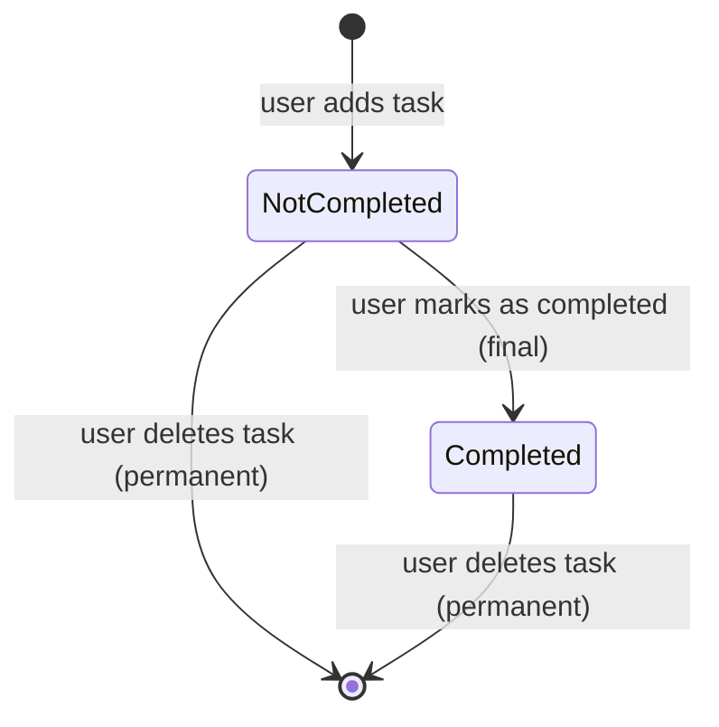

# Feature Specification: To-Do List

**Feature Branch**: `001-todo-list`

**Created**: 2026-10-13

**Status**: Approved
**Approved**: 2026-10-13 — Business team

**Input**: User description: "Build a simple To-Do List application where users can create tasks with a title, view all tasks, mark tasks as completed, and delete tasks."

## Clarifications

### Session 2026-10-13

- Q: Do users sign in and see only their own tasks, or is there one shared task list? → A: No sign-in; there is
  one shared task list for everyone who opens the application, and anyone can view, add, complete and delete any
  task.
- Q: Can a completed task be marked as not completed again? → A: No; completion is final.
- Q: Must the user confirm before a task is deleted, and can a deleted task be recovered? → A: No confirmation; the
  task is deleted immediately and permanently.
- Q: What is the longest title a task can have, and what happens if someone types more? → A: 100 characters; the
  user cannot type past the limit.
- Q: Can two tasks in the list have exactly the same title? → A: Yes; duplicate titles are allowed with no warning.
- Q: In what order should tasks appear in the list, and do completed tasks stay where they are or move to the end?
  → A: Newest first; completed tasks stay in place.

## User Scenarios & Testing *(mandatory)*

### User Story 1 - Add a task and see it in the list (Priority: P1)

A user opens the application, types a short title for something that needs doing and adds it. The task appears in
the shared task list straight away, marked as not completed. No sign-in is needed. When anyone opens the
application later, the task is still there.

**Why this priority**: Capturing tasks and seeing them is the core of a to-do list. Without it no other story has
anything to act on, and on its own it already gives people a place to write down what needs doing.

**Independent Test**: Open the application with no tasks, add two tasks with different titles, and check that
both appear in the list as not completed and are still there after the application is closed and reopened.

**Acceptance Scenarios**:

1. **Given** the task list has no tasks, **When** a user opens the application, **Then** they see the task list
   without being asked to sign in, a message saying there are no tasks yet, and the field for adding a task.
2. **Given** a user is on the task list, **When** they enter the title "Buy milk" and add the task, **Then** a
   task titled "Buy milk" appears in the list, marked as not completed, and the title field is cleared.
3. **Given** a user is on the task list, **When** they try to add a task with an empty title or a title made only
   of spaces, **Then** no task is created and they see a message that a title is required.
4. **Given** tasks have been added, **When** the application is closed and opened again, **Then** the same tasks
   are shown with the same titles and completion states.
5. **Given** the list has several tasks, **When** a user opens the application, **Then** every task is shown with
   its title and whether it is completed.
6. **Given** a user has typed 100 characters in the title field, **When** they type or paste more, **Then** the
   field still holds only the first 100 characters, and adding the task saves that 100-character title.
7. **Given** the list already has a task titled "Buy milk", **When** a user adds another task titled "Buy milk",
   **Then** it is added with no warning and the list shows two separate "Buy milk" tasks.
8. **Given** the list has "Buy milk" added before "Call Sam", **When** a user adds "Pay rent", **Then** the list
   shows, from top to bottom, "Pay rent", "Call Sam", "Buy milk".

---

### User Story 2 - Mark a task as completed (Priority: P2)

A user who has finished something marks that task as completed. The list shows clearly which tasks are done and
which are still open. Completing a task is final.

**Why this priority**: Tracking progress is the main reason to keep a to-do list after tasks have been written
down, but it needs Story 1's tasks to exist first.

**Independent Test**: With one not-completed task in the list, mark it as completed and check that it is shown as
completed, stays completed after the application is reopened, offers no way to mark it as not completed, and the
other tasks are unchanged.

**Acceptance Scenarios**:

1. **Given** the list has a not-completed task "Buy milk", **When** a user marks it as completed, **Then** "Buy
   milk" is shown as completed, visibly different from tasks that are not completed.
2. **Given** "Buy milk" has been marked as completed, **When** the application is reopened, **Then** "Buy milk" is
   still shown as completed.
3. **Given** the list has the tasks "Buy milk" and "Call Sam", **When** a user marks "Buy milk" as completed,
   **Then** "Call Sam" stays not completed.
4. **Given** the list has a completed task "Buy milk", **When** a user looks at that task, **Then** no action to
   mark it as not completed is offered, and it stays completed.
5. **Given** the list shows, from top to bottom, "Pay rent", "Call Sam", "Buy milk", **When** a user marks "Call
   Sam" as completed, **Then** the order stays "Pay rent", "Call Sam", "Buy milk".

---

### User Story 3 - Delete a task (Priority: P3)

A user removes a task that is no longer needed, completed or not, so the list holds only what matters. The task is
removed at once, with no confirmation, and cannot be recovered.

**Why this priority**: Deleting keeps the list tidy, but the list is still useful without it.

**Independent Test**: With two tasks in the list, delete one and check that it disappears immediately without a
confirmation step, and that only the other task remains, including after the application is reopened.

**Acceptance Scenarios**:

1. **Given** the list has the tasks "Buy milk" and "Call Sam", **When** a user deletes "Buy milk", **Then** "Buy
   milk" is removed immediately, without a confirmation step, and only "Call Sam" remains in the list.
2. **Given** the list has a completed task, **When** a user deletes it, **Then** it is removed from the list.
3. **Given** a task has been deleted, **When** the application is reopened, **Then** the deleted task does not
   appear and no way to restore it is offered.
4. **Given** the list has only one task, **When** a user deletes it, **Then** they see the message that there are
   no tasks yet.

---

### Edge Cases

- A title with spaces before or after the text is saved without those spaces; a title made only of spaces counts
  as empty and is rejected (US1-AS3).
- A single add action creates exactly one task, even if the user triggers it twice in quick succession.
- If a task cannot be saved, completed or deleted (for example the connection is lost), the user sees a message
  that the action failed, and the list keeps showing the task's last saved state; nothing is shown as saved when it
  was not.
- Because the list is shared, a task may already have been deleted by someone else when a user tries to complete
  or delete it. The user is told the task no longer exists, and it is removed from their list.
- A title is at most 100 characters; the title field does not accept more, whether typed or pasted (US1-AS6).
- Two tasks with the same title are allowed; each is a separate task that is completed and deleted on its own
  (US1-AS7).

## Requirements *(mandatory)*

### Functional Requirements

- **FR-001**: Users MUST be able to create a task by entering a title of up to 100 characters. The title field MUST
  NOT accept more than 100 characters, whether typed or pasted. Titles do not have to be unique; a title that
  matches an existing task MUST be accepted without a warning.
- **FR-002**: The system MUST reject a task whose title is empty or made only of spaces, and tell the user a title
  is required.
- **FR-003**: The system MUST remove spaces before and after a title when the task is saved.
- **FR-004**: A newly created task MUST start as not completed.
- **FR-005**: Users MUST be able to view all tasks in one list, each showing its title and whether it is
  completed. The list MUST be ordered newest first, by when each task was created; completing a task MUST NOT
  change its position.
- **FR-006**: The list MUST show a message when there are no tasks.
- **FR-007**: Users MUST be able to mark a not-completed task as completed.
- **FR-008**: Completed tasks MUST be visibly distinguishable from tasks that are not completed.
- **FR-009**: Completion MUST be final: the system MUST NOT offer any way to mark a completed task as not
  completed.
- **FR-010**: Users MUST be able to delete any task, completed or not; a deleted task no longer appears in the
  list.
- **FR-011**: Deletion MUST happen immediately, without a confirmation step, and MUST be permanent: a deleted task
  cannot be restored.
- **FR-012**: Tasks, their titles and their completion states MUST be kept until someone deletes them, including
  when the application is closed and reopened.
- **FR-013**: The list MUST reflect each create, complete and delete action made by the user as soon as the action
  succeeds, without the user having to reload.
- **FR-014**: When an action fails, the system MUST tell the user in plain language and MUST NOT show the action
  as done.
- **FR-015**: There MUST be no sign-in. The application holds one shared task list, and anyone who opens the
  application MUST be able to view, add, complete and delete any task in it. This public access is declared
  deliberately (Constitution, Principle I).
- **FR-016**: Every action in this feature (add, view, complete, delete) MUST be usable with a keyboard alone and
  with a screen reader (Constitution, Principle II).

### Key Entities

- **Task**: something that needs doing, held in the one shared task list. Has a title (required text, 1–100
  characters, not necessarily unique), a
  completion state (not completed or completed), and the moment it was created (which sets its place in the list).
  A task does not belong to any
  particular person.

## Success Criteria *(mandatory)*

### Measurable Outcomes

- **SC-001**: A first-time user can add a task in under 10 seconds from opening the application.
- **SC-002**: At least 95 % of first-time users add, complete and delete a task on their first attempt without
  help.
- **SC-003**: After any add, complete or delete action, the list shows the result within 1 second in normal use.
- **SC-004**: 100 % of tasks and completion states that were shown as saved are still present and unchanged after
  the application is closed and reopened.
- **SC-005**: Every action in the feature can be completed using only a keyboard, and every task's title and
  completion state is announced by a screen reader.

## Dependencies *(mandatory)*

- **Depends on**: None
- **Related**: None
- **External**: None

## Assumptions

- The application is the single web channel described in the Constitution's Platform Scope, in English.
- Messages to the user (title required, action failed, no tasks yet, task no longer exists) are short and in plain
  language.
- Changes made by other people appear the next time the list is loaded; showing other people's changes live is
  not part of this feature.
- Editing a task's title, due dates, priorities, categories, search, filtering and sign-in are out of scope for
  this feature because the request names only create, view, complete and delete.
- The shared list holds a normal number of tasks (up to a few hundred); larger lists are not a goal of this
  feature.
